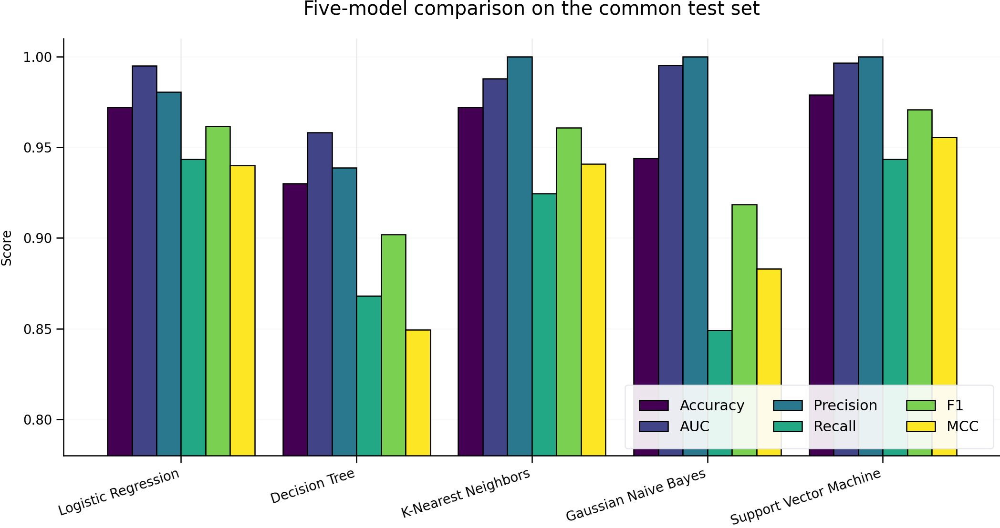

# Machine Learning Assignment 2 - Diagnostic Model Lab

> **Student:** Sangram Jadhav  
> **BITS ID:** `[ADD YOUR BITS ID]`  
> **Section:** `[ADD YOUR SECTION]`

## Mandatory submission links

1. **GitHub repository:** `[ADD YOUR CLICKABLE GITHUB REPOSITORY URL]`
2. **Live Streamlit app:** `[ADD YOUR CLICKABLE STREAMLIT APP URL]`
3. **BITS Virtual Lab evidence:** Insert your own screenshot in the final PDF after running this project on the BITS Virtual Lab.

---

## a. Problem statement

The objective is to build an end-to-end binary classification workflow that predicts whether a breast mass is **malignant** or **benign** from diagnostic measurements. Five machine-learning classifiers are trained on the same training partition and evaluated on the same untouched test partition. The project also provides an interactive Streamlit application that loads the fitted models and evaluates an uploaded test CSV **without retraining**.

The implemented classifiers are:

1. Logistic Regression
2. Decision Tree Classifier
3. K-Nearest Neighbors Classifier
4. Gaussian Naive Bayes Classifier
5. Support Vector Machine

The required evaluation measures are Accuracy, ROC-AUC, Precision, Recall, F1 score, and Matthews Correlation Coefficient (MCC).

## b. Dataset description

**Dataset:** Breast Cancer Wisconsin (Diagnostic)  
**Public repository:** UCI Machine Learning Repository  
**UCI page:** https://archive.ics.uci.edu/dataset/17/breast+cancer+wisconsin+diagnostic  
**DOI:** https://doi.org/10.24432/C5DW2B

The dataset contains **569 instances**, **30 real-valued input features**, and two classes. It therefore satisfies the assignment minimum of 500 instances and 12 features. The measurements are computed from digitized fine-needle-aspirate images of breast masses and describe properties of cell nuclei, including radius, texture, perimeter, area, smoothness, compactness, concavity, concave points, symmetry, and fractal dimension. The project uses the copy supplied by `sklearn.datasets.load_breast_cancer`.

### Target encoding used in this project

| Value | Class |
|---:|---|
| 0 | Benign |
| 1 | Malignant |

The original scikit-learn target is recoded so that **malignant is the positive class**. This makes precision, recall, F1, and ROC-AUC directly describe malignant-case detection.

### Experimental design

- Stratified train/test split: **75% training, 25% testing**
- Random state: **42**
- Training rows: **426**
- Test rows: **143**
- The exported `test_data.csv` includes all 30 features and the `target` column.
- Median imputation is stored inside each fitted pipeline.
- Standardization is stored in the Logistic Regression, KNN, and SVM pipelines.
- The Decision Tree and Gaussian Naive Bayes pipelines use unscaled numeric values.
- No model is retrained by the Streamlit application.

## c. GitHub Repository Link

**Repository link:** `[ADD YOUR CLICKABLE GITHUB REPOSITORY URL]`

### Required repository contents

```text
ML_Assignment_2_Solution/
|-- app.py
|-- train_models.py
|-- requirements.txt
|-- README.md
|-- test_data.csv
|-- metrics.csv
|-- model/
|   |-- logistic_regression.joblib
|   |-- decision_tree.joblib
|   |-- knn.joblib
|   |-- naive_bayes.joblib
|   |-- support_vector_machine.joblib
|   `-- metadata.json
`-- .streamlit/
    `-- config.toml
```

## d. Models used and comparison table

The following results were produced on the common 143-row stratified test set. Values are rounded to four decimal places.

| ML Model Name | Accuracy | AUC | Precision | Recall | F1 | MCC |
|---|---:|---:|---:|---:|---:|---:|
| Logistic Regression | 0.9720 | 0.9950 | 0.9804 | 0.9434 | 0.9615 | 0.9400 |
| Decision Tree | 0.9301 | 0.9583 | 0.9388 | 0.8679 | 0.9020 | 0.8493 |
| K-Nearest Neighbors | 0.9720 | 0.9879 | 1.0000 | 0.9245 | 0.9608 | 0.9408 |
| Gaussian Naive Bayes | 0.9441 | 0.9952 | 1.0000 | 0.8491 | 0.9184 | 0.8830 |
| Support Vector Machine | **0.9790** | **0.9964** | **1.0000** | **0.9434** | **0.9709** | **0.9555** |



### Metric definitions

- **Accuracy:** fraction of all test cases classified correctly.
- **AUC:** area under the ROC curve, measuring ranking ability across thresholds.
- **Precision:** fraction of predicted malignant cases that are actually malignant.
- **Recall:** fraction of actual malignant cases correctly detected.
- **F1:** harmonic mean of precision and recall.
- **MCC:** balanced correlation between actual and predicted labels; it uses all four confusion-matrix cells and is informative when classes are unequal.

## e. Observations about model performance

| ML Model Name | Observation about model performance |
|---|---|
| Logistic Regression | Strong and well-balanced results: 0.9720 accuracy, 0.9434 malignant recall, and 0.9400 MCC. Its high AUC (0.9950) indicates excellent class ranking, while its linear form provides a useful, relatively interpretable baseline. |
| Decision Tree | This was the weakest model in the comparison, with 0.9301 accuracy, 0.8679 recall, and 0.8493 MCC. A single tree is easy to explain, but its axis-aligned splits did not generalize as well as the scaled linear and kernel methods on this test set. |
| K-Nearest Neighbors | KNN reached 1.0000 precision and 0.9720 accuracy. Its 0.9245 recall shows that it made no false-positive malignant predictions but missed more malignant cases than Logistic Regression and SVM. Scaling is essential because KNN is distance-based. |
| Gaussian Naive Bayes | Gaussian NB produced excellent AUC (0.9952) and 1.0000 precision, but its 0.8491 recall was the lowest of the five models. It ranked cases well but, at its default classification threshold, missed comparatively more malignant cases. Its conditional-independence assumption is restrictive because diagnostic features can be correlated. |
| Support Vector Machine | SVM achieved the best overall test performance: 0.9790 accuracy, 0.9964 AUC, 0.9709 F1, and 0.9555 MCC, with 1.0000 precision and 0.9434 recall. Standardization and the RBF kernel allow it to model nonlinear boundaries in the feature space. |
| **Overall winner for this dataset** | **Support Vector Machine**, because it obtained the highest Accuracy, AUC, F1, and MCC while maintaining the joint-highest recall and perfect precision on this test split. This conclusion applies to the fixed split and chosen hyperparameters; cross-validation would be needed for a stronger generalization claim. |

---

## Streamlit application features

The app implements all four features required by the assignment:

1. **CSV upload:** accepts only test data containing all 30 input features and `target`.
2. **Model selection dropdown:** selects any of the five saved classifiers.
3. **Evaluation metrics:** displays Accuracy, AUC, Precision, Recall, F1, and MCC.
4. **Confusion matrix and classification report:** displays both for the selected model.

It also includes an all-model comparison table, a comparison chart, data validation, a test-data preview, and downloadable predictions. Models are loaded from `.joblib` files; the app never calls `.fit()`.

## Run on BITS Virtual Lab

```bash
# 1. Open a terminal in the project folder
python -m venv .venv

# 2. Activate the environment (Linux)
source .venv/bin/activate

# 3. Install dependencies
pip install -r requirements.txt

# 4. Optional: reproduce the models and test split
python train_models.py

# 5. Launch the application
streamlit run app.py
```

Open the local URL shown by Streamlit. Upload `test_data.csv`, select models, and capture **one screenshot on the BITS Virtual Lab** showing the application and enough of the lab environment to serve as genuine proof.

## Deploy on Streamlit Community Cloud

1. Create a new GitHub repository in your own account.
2. Add these files and make several meaningful commits as you implement and verify the project.
3. Push the repository to the `main` branch.
4. Visit https://streamlit.io/cloud and sign in using GitHub.
5. Choose **New App**.
6. Select your repository and the `main` branch.
7. Set the main file path to `app.py`.
8. Click **Deploy**.
9. Verify that the app opens, the sample CSV loads, every model can be selected, and the metrics/confusion matrix appear.
10. Copy the deployed URL into this README and the final assignment PDF.

## Reproducibility

To recreate every saved model and metric:

```bash
python train_models.py
```

The script uses a fixed split and writes `metrics.csv`, `test_data.csv`, five fitted pipelines, and `model/metadata.json`.

## Final submission checklist

- [ ] Replace student BITS ID and section placeholders.
- [ ] Replace the GitHub URL placeholder with a working clickable repository link.
- [ ] Replace the Streamlit URL placeholder with a working clickable app link.
- [ ] Run the project on BITS Virtual Lab.
- [ ] Insert one genuine BITS Virtual Lab execution screenshot in the final PDF.
- [ ] Verify that `test_data.csv` works when uploaded.
- [ ] Verify all five model selections and the all-model comparison.
- [ ] Confirm the app loads without errors on Streamlit Community Cloud.
- [ ] Confirm the final PDF contains links, screenshot, and the complete README content.
- [ ] Submit the final version, not a draft, by the stated deadline.

## Academic-integrity note

The assignment states that plagiarism results in zero marks and that AI tools may be used only for learning support. Review and understand the complete workflow, rerun it yourself on the BITS Virtual Lab, customize the implementation and interface, and maintain your own authentic Git history before submission.
